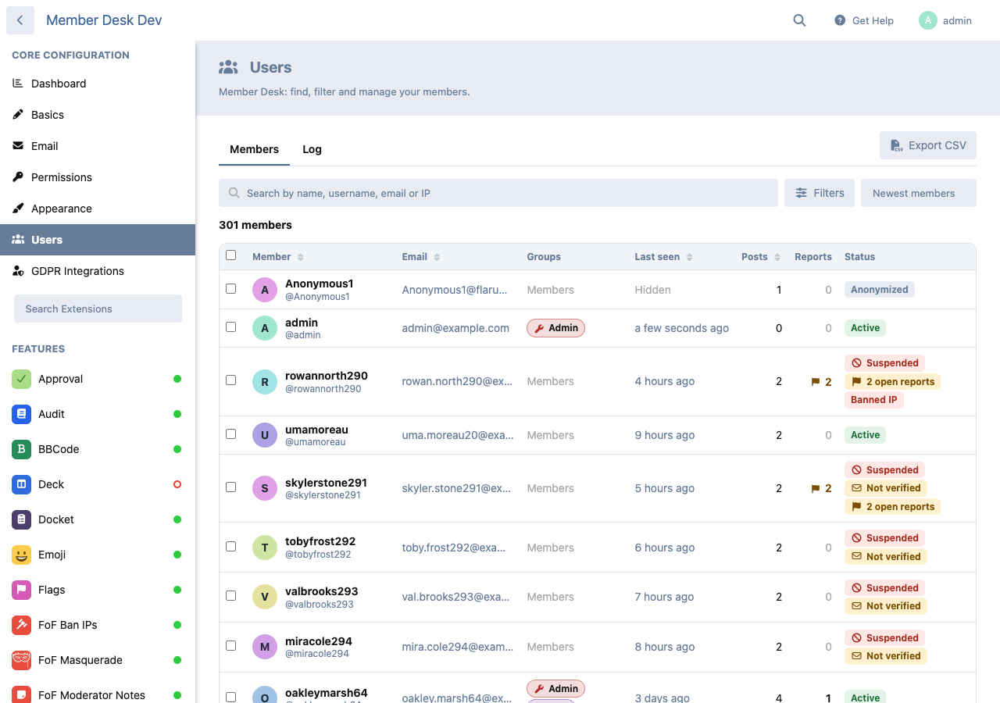
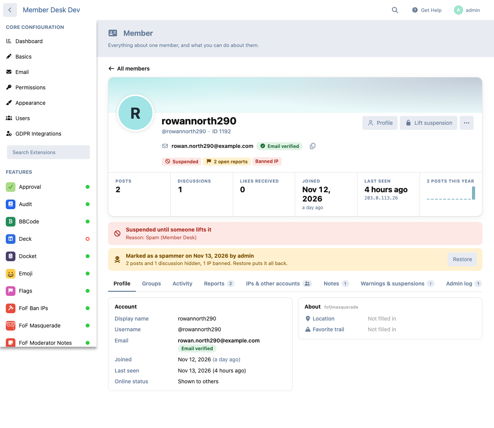
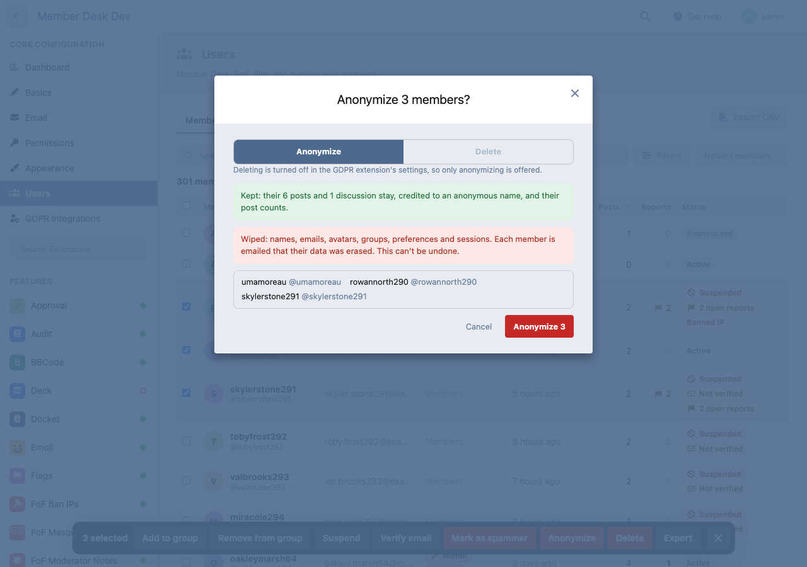
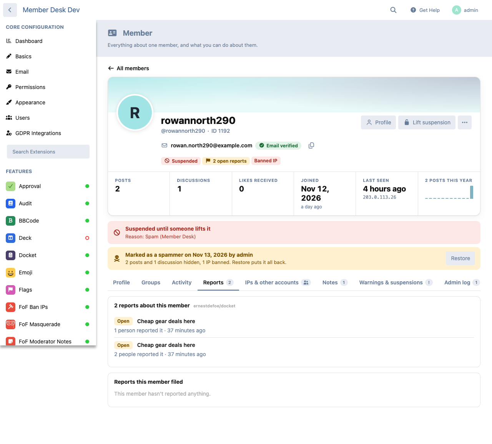
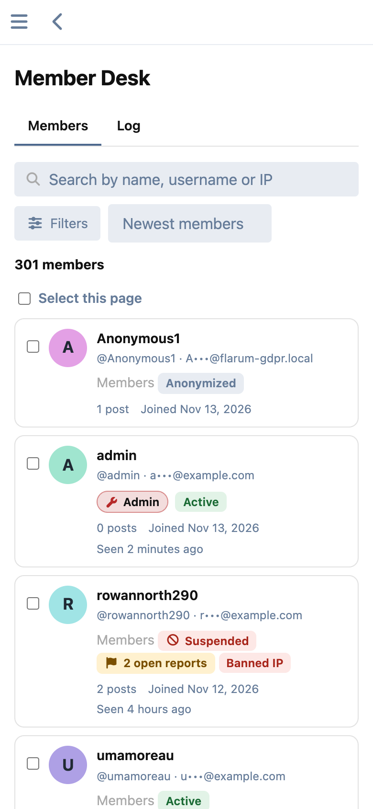

# Member Desk

An Invision-style members area for Flarum 2. Find any member in seconds, see everything about them on one page, and act on one or a thousand of them with a confirmation that tells you exactly what happens.



- **Replaces the admin's Users page** (Flarum's own page comes back if you switch Member Desk off) with a searchable, sortable list: groups, join date, last visit, posts, discussions, last IP, reports and status.
- **Filters and saved filters:** group (or no extra group), joined or last seen in a period or between dates, email not verified, suspended, anonymized, never posted, banned IP, post counts, and reported N+ times. Save any set under a name; admins can share theirs with all staff.
- **Bulk actions with an honest confirmation:** add to or remove from a group, suspend, verify email, mark as spammer, anonymize and delete. The confirmation names how many members, what is kept and what goes, lists them, and says who is skipped and why. Erasing 25 or more members, or any delete, asks you to type the count. Large batches run in the background.
- **A member page that shows everything at once:** status and email verification at a glance, their numbers and a year of activity, then tabs for profile and custom fields, groups, activity and devices, reports, IP addresses with the other accounts on them, staff notes, warnings and suspensions, and the admin log.
- **Mark as spammer, and undo it:** suspends the member, hides their posts and discussions and bans their IPs (FoF Ban IPs). Restore puts back exactly what it hid. An address an active member also uses is never banned, and neither is yours.
- **Anonymize and delete through flarum/gdpr's own erasure**, so its settings and emails apply. Without it, Delete uses Flarum's own user delete.
- **Reports:** with [Docket](https://github.com/ernestdefoe/docket), each member's reports (status, who handles them, outcome) and the reports they filed. With Flags alone, report counts.
- **A log of every action:** who did what, to whom and when, and the member as they were.
- **CSV export** of any filter or selection.
- **For moderators too:** staff you allow get the same list and member pages on the forum at `/member-desk`.









## Install

```sh
composer require ernestdefoe/member-desk
php flarum migrate
php flarum cache:clear
```

Pruning erased members' log entries needs Flarum's scheduler (`php flarum schedule:run` every minute from cron).

## Update

```sh
composer update ernestdefoe/member-desk
php flarum migrate
php flarum cache:clear
```

## Permissions

Member Desk shows members' emails, IP addresses and history, so **after installing only admins can use it.** Give other groups access on the Permissions page:

| Permission | What it allows |
| --- | --- |
| Open Member Desk | The list and member pages (emails masked) |
| See members' full email addresses | Full emails, and searching by email |
| See members' IP addresses | The IP column, IP search, the banned-IP filter and the IPs tab |
| Mark members as spammers | Mark as spammer and Restore |
| Export members as CSV | CSV export (also needs full emails) |

Groups, suspensions and email verification use Flarum's own permissions (edit groups, suspend, edit credentials). Anonymize and delete are for admins only, and nobody can act on their own account or on an admin.

## Privacy

Every action is written to the log before it runs. When a member is anonymized or deleted, their email and IP addresses are kept only as HMAC-SHA256 hashes salted with a secret only your forum has: **pseudonymous, not anonymous** (someone holding both your database and that secret could test guesses). An admin can check whether an address belonged to an erased member, but can't read it back. After 90 days (you can change this) even the names and hashes are removed. Staff see only what their own permissions allow: last-seen times, hidden groups, IPs and suspension reasons follow the same rules as everywhere else.

## Works with

flarum/gdpr, flarum/suspend, flarum/audit, flarum/flags, ernestdefoe/docket, fof/ban-ips, fof/moderator-notes, fof/moderator-warnings and fof/masquerade, each only when it's installed.

MIT licensed. ☕ [Buy me a coffee](https://buymeacoffee.com/ernestdefoe)
